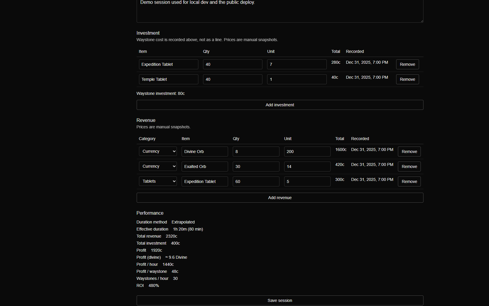
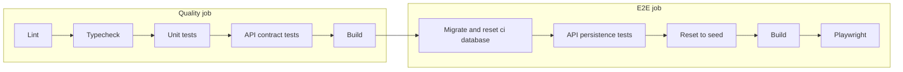

# POE Profit

[](https://github.com/TaylorOlson77/POE-Profit/actions/workflows/ci.yml)

Profit tracker for Path of Exile 2 farming strategies. You record what a farming session cost and what it returned, and the app calculates profit, ROI, profit per hour, and profit per map.

Live demo: [poe-profit.vercel.app](https://poe-profit.vercel.app/) (demo data, no login)



## Tests

| Layer           | Tool       | Tests | Location           | Covers                                                            |
| --------------- | ---------- | ----: | ------------------ | ----------------------------------------------------------------- |
| Unit            | Jest       |   145 | `src/**/*.test.ts` | Calculation engine, rounding, form transforms                     |
| API contract    | Jest       |    33 | `tests/api/`       | Status codes, validation errors, calculated fields in responses   |
| API persistence | Jest       |     7 | `tests/api/db/`    | Round-trips against real Postgres: decimal scale, limits, deletes |
| E2E             | Playwright |    15 | `e2e/`             | Create, edit, and delete for strategies and sessions; home smoke; axe scan of the six pages |

Counts as of 2026-10-31.

Most of the tests are unit tests on the calculation engine, since a wrong profit or ROI number is the main risk. API tests cover the contract and persistence, and Playwright covers the main user journeys without repeating validation cases.

## CI

GitHub Actions runs on every pull request and push to `main`.



- Contract tests use a Prisma fake and need no database.
- The E2E job uses a separate Neon `ci` branch, not the demo site's database.
- E2E runs are queued so two jobs don't reset the same database at once.
- A failed Playwright test retries once.
- The [latest Playwright report](https://taylorolson77.github.io/POE-Profit/) is the last run on `main` that executed Playwright. The next one replaces it. A pull request does not.
- A failed run also uploads `playwright-report/` and `test-results/` for 7 days. That zip is the trace download.

## Design notes

- Money is handled with `decimal.js` and stored as `Decimal(20, 8)`, never as a JavaScript `number`. Values are rounded only for display (ADR-015, ADR-021).
- The server calculates and stores derived fields on save. The UI displays the API response and doesn't do its own math (ADR-008, ADR-018).
- Local, CI, and production each use their own Neon database branch.

## AI-assisted development

Built with Cursor. I make the product and architecture calls, record them as ADRs, and every change goes through a pull request with passing CI. The working agreement is in [`docs/AI_DEVELOPMENT.md`](docs/AI_DEVELOPMENT.md), and the ticket workflow prompts are in [`.cursor/commands/`](.cursor/commands/).

## Run locally

Requires Node.js 22.

```bash
npm install
npm run dev        # http://localhost:3000
npm test           # unit tests
npm run test:api   # API contract tests
```

The app, persistence tests, and Playwright need a Postgres database. See [`docs/DEVELOPMENT.md`](docs/DEVELOPMENT.md).

## Stack

Next.js, TypeScript, Zod, Prisma, Neon Postgres, `decimal.js`, Jest, Playwright, GitHub Actions, Vercel.
